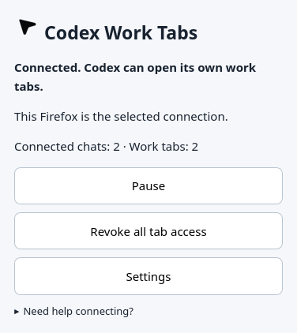
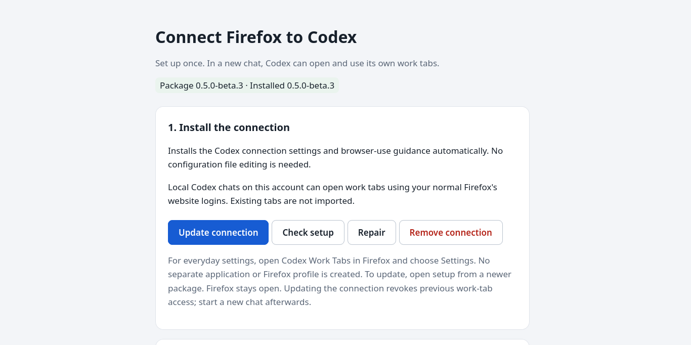

# Manage the connection in Firefox

Instructions for **Linux 0.4.3 stable** and **Windows 0.5.0-beta.3 preview**.
Use the [Linux installation guide](first-install-linux.md) or
[Windows preview guide](windows-preview.md) for the matching download. Linux uses
RPM/DEB by default, with tar.gz as a fallback. The Windows beta.3 ZIP and older
release files remain unchanged. All include Mozilla-signed English extension
**Codex Work Tabs 0.4.2** for unlisted/direct distribution.

## Install once, then use ordinary Firefox

1. Install ordinary desktop Firefox and sign in to the local Codex app or CLI.
2. On Linux, install the RPM/DEB with your software manager, then install the
   release's signed XPI in Firefox. On Windows, extract the beta.3 ZIP,
   double-click `firefox-codex-mcp.exe` as your normal user and choose **Install
   connection → Continue → Add Codex Work Tabs to Firefox**.
3. On Linux, click **Codex Work Tabs → Settings → Connect Codex → Continue** as
   your normal user. It registers only that account's Codex connection, skill and
   browser guidance. Repeat for each OS account; never run Connect with `sudo`.
4. Start a new Codex chat and ask:

   > Open https://example.com in the browser, click Learn more, and tell me the destination page title.

The RPM/DEB installs one system helper. The Windows ZIP and Linux tar.gz install
a private helper per user. Install the extension in your everyday Firefox
profile. The extension cannot install a native program by itself. No additional
Firefox profile, app-menu launcher, pairing code or manually installed skill is
needed for ordinary use.

## Manage from the extension

Open ordinary Firefox and click **Codex Work Tabs → Settings**. The page opens in
that same Firefox profile. It provides **Check setup** and **Repair**, plus
**Disconnect Codex** for Linux packages or **Remove connection** for the Windows
and tar.gz installations. Pause, resume and revoke controls stay in the extension.
Firefox's Add-ons Manager can also open those controls and their **Settings** button.

With several profiles, choose **Use this Firefox** in the intended one. A single
connected profile is selected automatically. An offline selected profile never
silently falls back to another. Existing profiles, website logins and result tabs
are preserved throughout setup, updates and removal.

## Program updates and removal

| Installation | Update the helper | Remove it completely |
| --- | --- | --- |
| Linux RPM/DEB | Install the newer package with the software manager | **Disconnect Codex** for each account, then remove `firefox-codex-mcp` with the software manager |
| Linux tar.gz | Extract the newer archive, run `./install.sh`, choose **Update connection** | **Settings → Remove connection**, or `./install.sh --uninstall` |
| Windows beta.3 ZIP | Extract the newer ZIP, run its EXE, choose **Update connection** | **Settings → Remove connection**, or Windows Settings → Apps → Firefox Codex MCP → Uninstall |

Linux package **Disconnect Codex** removes the current user's owned configuration,
skill and guidance, revoking work-tab access. It leaves the system helper for
other users and later reconnection. OS package removal stops running packaged
helpers even for users who did not disconnect, but never edits their home folders.
Their leftover registrations cannot launch the removed program. To clean them,
reinstall the package and disconnect, or extract the current tar.gz and run
`./install.sh --uninstall` as the affected user. [Package ownership and recovery](linux-packages.md).

Local RPM/DEB files do not add an automatic APT/DNF update repository and have no
separate package/repository signature. The Mozilla-signed extension has its own
installation; install a newer signed XPI when a release calls for one.
Direct-distribution XPIs currently have no automatic extension update channel.
Updates release previous work-tab access and leave result tabs open. Start a new
Codex chat afterwards. An already-dispatched browser action cannot be undone.

If the extension cannot reach the helper, run `firefox-codex-mcp --manage` on a
packaged Linux installation, `./install.sh` from a Linux fallback archive, or the
extracted Windows EXE. If the system command is missing or its installation is
damaged, reinstall the RPM/DEB with the software manager. The extension cannot
repair a helper it cannot reach. Removing the Firefox add-on alone leaves the
helper and Codex connection settings; remove the add-on separately if desired.

## Existing installations

To switch from tar.gz to RPM/DEB, install the package and choose **Reconnect
Codex** in Settings. Setup switches the Codex command to the fixed system helper
and retires unchanged, receipt-owned user binaries, native registrations and old
**Firefox Codex Manager** / **Firefox (Codex connection)** launchers. Modified
files remain and are reported. A modified or foreign per-user native registration
can mask the system helper, so it blocks migration with a clear error. Review the
reported file before moving it yourself; keep a backup. Firefox itself is not
terminated.

Older BiDi debugging installations remain an advanced command-line compatibility
path. Install the default extension connection to use Firefox-based management.
No debugging launcher is created. Advanced users can use `--launch-firefox PROFILE`
after saving their work and closing Firefox; this is outside normal installation.

## Verification scope

The release's `release-verification.json` identifies its exact artifacts and CI.
Linux RPM/DEB lifecycle checks, historical clean-home actual-model work and Windows
Server integration tests are distinct evidence. Automated headless checks do not
establish novice usability or a fresh desktop OS installation. Windows 10/11
desktop and SmartScreen acceptance remain pending.

The screenshots below show the signed 0.4.2 extension and a beta.3 candidate
helper in a disposable Linux Firefox 160 profile. The older Settings screenshot
precedes the Linux package Connect/Disconnect labels. It is historical evidence,
not a screenshot of the 0.4.3 package flow.

Original scope: [2026-11-17 source-preparation record](firefox-only-management-e2e-2026-11-17.json).
